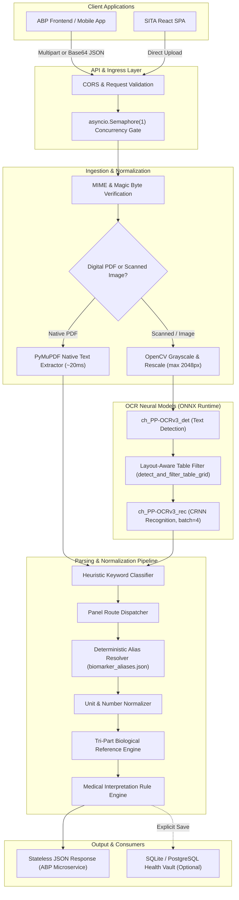

# SITA OCR Engine — Architecture & Integration Documentation

> **Target Audience:** Integration Engineers, Backend Developers, and System Architects  
> **Service Name:** SITA OCR & Health Vault Microservice  
> **Production Endpoint:** `https://sita-ocr.onrender.com/api/v1`  
> **Repository:** `Sita_OCR`  

---

## 1. System Overview & Purpose

The **SITA OCR Engine** is a medical lab report extraction and clinical interpretation microservice. It transforms unstructured or semi-structured diagnostic reports (PDFs, scans, smartphone camera captures) into validated, structured clinical biomarker datasets compatible with Supabase and relational health-record schemas.

### Core Capabilities:
- **Zero-Data-Retention Microservice Processing:** Stateless extraction endpoints (`/api/v1/ocr/process`) process and enrich medical reports without storing sensitive patient images or binaries on server disks.
- **Dual PDF Engine:** Instant vector text extraction for native digital PDFs via PyMuPDF (~10–50ms) with automated fallback to neural OCR for scanned/rasterized documents.
- **Deterministic Medical Interpretation:** Local, non-hallucinatory rule engine mapping biomarker ranges, critical alert statuses, multi-biomarker patterns (e.g., De Ritis Ratio, Microcytic Anemia), and clinical summaries.
- **Strict Free-Tier Resource Footprint:** Tuned to operate within a **512 MB RAM ceiling** without OOM crashes, employing single-thread ONNX execution, glibc arena limits, and canvas-based client pre-scaling.

---

## 2. End-to-End System Architecture



---

## 3. Neural OCR Models & Specifications

The engine leverages **RapidOCR** backed by **ONNX Runtime (CPU Execution Provider)**. These models execute in C++ with vectorized CPU SIMD instructions:

| Model Stage | Model Asset | Weights Size | Framework / Arch | Purpose & Tuning |
|---|---|---|---|---|
| **Text Detection** | `ch_PP-OCRv3_det_infer.onnx` | 2.3 MB | Differentiable Binarization (DBNet) | Locates text bounding boxes across distorted or angled medical forms. |
| **Text Recognition** | `ch_PP-OCRv3_rec_infer.onnx` | 10.2 MB | MobileNetV3 + CRNN + CTC Loss | Vectorized recognition of alphanumeric lab parameters, numbers, and units. Batch size clamped to `rec_batch_num = 4` to stay under RAM limits. |
| **Orientation / Cls** | `ch_ppocr_mobile_v2.0_cls_infer.onnx` | 0.6 MB | MobileNetV2 Angle Classifier | Evaluates 0°/180° orientation when orientation normalization is triggered. |

### Memory & Execution Profile
- **Total Combined Model Footprint:** ~13.1 MB on disk; ~98 MB resident in RAM.
- **Threading Model:** `intra_op_num_threads = 1`, `inter_op_num_threads = 1`.
- **Memory Allocator Constraints:** `enable_cpu_mem_arena = False`, `MALLOC_ARENA_MAX = 2`.
- **Post-Inference Cleanup:** Immediate `del img`, `gc.collect()`, and `ctypes.CDLL('libc.so.6').malloc_trim(0)` releases heap back to the operating system immediately.

---

## 4. Supported Lab Report Panels

The service features heuristic-based auto-classification and targeted rule parsers for all standard clinical panels:

1. **Complete Blood Count (CBC / FBC / Hemogram)**
   - Biomarkers: Hemoglobin, RBC Count, WBC Count (TLC), Platelets, PCV/Hematocrit, MCV, MCH, MCHC, RDW-CV, RDW-SD, Differential Count (Neutrophils, Lymphocytes, Monocytes, Eosinophils, Basophils), MPV.
2. **Liver Function Test (LFT / Hepatic Panel)**
   - Biomarkers: Total Bilirubin, Direct (Conjugated) Bilirubin, Indirect Bilirubin, ALT (SGPT), AST (SGOT), Alkaline Phosphatase (ALP), GGT, Total Protein, Albumin, Globulin, A/G Ratio, LDH.
3. **Kidney Function Test (KFT / RFT / Renal Panel)**
   - Biomarkers: Serum Urea, Blood Urea Nitrogen (BUN), Serum Creatinine, eGFR, Uric Acid, Calcium, Phosphorus, Electrolytes (Sodium, Potassium, Chloride, Bicarbonate), Urea/Creatinine Ratio.
4. **Lipid Profile**
   - Biomarkers: Total Cholesterol, HDL, LDL, VLDL, Triglycerides, Non-HDL Cholesterol, Total/HDL Ratio, LDL/HDL Ratio.
5. **Diabetes Monitoring**
   - Biomarkers: HbA1c, Estimated Average Glucose (eAG), Fasting Blood Glucose, Postprandial Blood Glucose.
6. **Thyroid Profile**
   - Biomarkers: T3 (Total/Free), T4 (Total/Free), TSH.
7. **Vitamin & Mineral Panels**
   - Biomarkers: Vitamin D (25-OH Total, D2, D3), Vitamin B12, Serum Ferritin, Serum Iron, Folate.

---

## 5. API Reference for Integration Team

### 5.1 Primary Microservice Endpoint: `POST /api/v1/ocr/process`

Designed specifically for automated backend-to-backend workflows (e.g., ABP, EHR systems). Accepts both standard **Multipart/form-data** and **JSON (Base64)** payloads.

#### Option A: Multipart/Form-Data
```http
POST /api/v1/ocr/process HTTP/1.1
Host: sita-ocr.onrender.com
Content-Type: multipart/form-data; boundary=---Boundary

---Boundary
Content-Disposition: form-data; name="user_id"

8f7c1234-5678-4321-abcd-ef0123456789
---Boundary
Content-Disposition: form-data; name="file"; filename="patient_lft.png"
Content-Type: image/png

<binary data>
---Boundary--
```

#### Option B: JSON Base64
```http
POST /api/v1/ocr/process HTTP/1.1
Host: sita-ocr.onrender.com
Content-Type: application/json

{
  "user_id": "8f7c1234-5678-4321-abcd-ef0123456789",
  "file": "iVBORw0KGgoAAAANSUhEUgAA...",
  "filename": "patient_lft.png"
}
```

#### Structured JSON Response (`200 OK`)
```json
{
  "success": true,
  "user_id": "8f7c1234-5678-4321-abcd-ef0123456789",
  "report_id": "2d513426-e041-467b-819c-be5fe4a62c0f",
  "report_type": "LFT",
  "processing_status": "completed",
  "processing_time_ms": 1420,
  "report": {
    "id": "2d513426-e041-467b-819c-be5fe4a62c0f",
    "report_id": "2d513426-e041-467b-819c-be5fe4a62c0f",
    "user_id": "8f7c1234-5678-4321-abcd-ef0123456789",
    "report_type": "LFT",
    "report_date": "2025-10-08",
    "collection_date": "2025-10-08T08:30:00Z",
    "reported_date": "2025-10-08T12:18:55Z",
    "ocr_status": "completed",
    "page_count": 1,
    "overall_status": "normal",
    "abnormal_count": 0,
    "analyzed_at": "2026-11-02T07:00:01.017076+00:00",
    "created_at": "2026-11-02T07:00:01.017076+00:00"
  },
  "biomarkers": [
    {
      "id": "c46bdcff-4e0b-44e7-81ff-d4ad46ac9aee",
      "user_id": "8f7c1234-5678-4321-abcd-ef0123456789",
      "report_id": "2d513426-e041-467b-819c-be5fe4a62c0f",
      "name": "Direct Bilirubin",
      "value": 0.2,
      "unit": "mg/dL",
      "reference_min": 0.0,
      "reference_max": 0.3,
      "reference_text": "0.0 - 0.3",
      "reference_source": "report",
      "status": "normal",
      "confidence": 0.77,
      "created_at": "2026-11-02T07:00:01.017076+00:00"
    }
  ],
  "performance": {
    "file_processing_time_ms": 12.0,
    "ocr_inference_time_ms": 1150.4,
    "parsing_time_ms": 25.1,
    "validation_time_ms": 2.5,
    "total_processing_time_ms": 1420.0
  }
}
```

---

### 5.2 Diagnostic & Interactive Analysis Endpoint: `POST /api/v1/medical-reports/analyze`

Provides deeper diagnostic payload for consumer frontends (includes cross-biomarker patterns, doctor discussion questions, historical trend overlays, and plain-English medical summaries).

#### Request (Multipart)
```http
POST /api/v1/medical-reports/analyze HTTP/1.1
Content-Type: multipart/form-data

file: <File binary>
patient_gender: male (optional)
user_id: <UUID> (optional)
```

#### Response Fields
- `summary`: High-level normal/abnormal count and primary takeaways.
- `patterns`: Correlated multi-marker anomalies (e.g., AST > ALT with elevated GGT indicating possible alcoholic liver pattern).
- `trends`: Comparison against previously stored health records if `user_id` matches.
- `explanation`: Educational paragraphs explaining findings without providing medical prescriptions.

---

### 5.3 Health Check & Readiness

| Endpoint | Method | Response | Description |
|---|---|---|---|
| `/` | `GET`, `HEAD` | `200 OK` | Render root liveness & automated uptime monitor probes. |
| `/api/v1/health` | `GET`, `HEAD` | `{"status":"healthy","service":"SITA OCR Engine"}` | Service health and database check. |
| `/api/v1/health/ocr` | `GET` | `{"status":"ready","provider":"RapidOCRProvider"}` | Verification that ONNX engine and weights are initialized. |

---

## 6. Integration Best Practices for Clients

### 1. Client-Side Image Optimization (Recommended)
Before uploading smartphone camera photos (>5–15 MB), resize images on the client side using an HTML5 Canvas or native mobile image utility:
- **Maximum Dimension:** Clamp width and height to **1200px** or **1600px**.
- **Compression:** JPEG at 85% quality.
- **Result:** Upload size drops from ~10 MB to ~350 KB, speeding up network transfer and keeping backend memory spikes to a minimum.
- *Note:* Do not pre-compress native digital PDF files — pass them as raw bytes so vector text extraction can run in ~20ms.

### 2. Handling Cold Starts on Free Tier
Render spins down free web services after 15 minutes of inactivity.
- **Cold start penalty:** 30–50 seconds on the first ping.
- **Recommended Client Timeout:** Set HTTP client timeout to **90–120 seconds**.
- **Keep-Alive:** Setup an automated health probe (`GET /api/v1/health` every 10 minutes) using UptimeRobot or Cron to keep the service warm during operational hours.

### 3. Error Handling Matrix

| HTTP Status | Error Code | Cause | Recommended Client Action |
|---|---|---|---|
| `400 Bad Request` | `INVALID_USER_ID` | Missing or non-UUID `user_id` | Validate ABP user UUID before making request. |
| `400 Bad Request` | `INVALID_FILE_FORMAT` | File extension not in `.pdf`, `.png`, `.jpg`, `.jpeg`, `.webp` | Prompt user to upload supported lab document. |
| `400 Bad Request` | `EMPTY_FILE` | Upload byte length is 0 | Check file selector or camera capture buffer. |
| `409 Conflict` | `duplicate_report` | Identical file SHA-256 already saved to vault | Notify user that report is already processed. |
| `413 Payload Too Large` | `FILE_TOO_LARGE` | File exceeds 20 MB ceiling | Downscale client image or compress PDF. |
| `504 Gateway Timeout` | `OCR_TIMEOUT` | Complex scanned document exceeded timeout | Retry with a cropped/higher-contrast single page. |

---

## 7. Local Development & Docker Deployment

### Local Development Setup
```bash
# 1. Clone repository
git clone https://github.com/navadeepsitacorp21/Sita_OCR.git
cd Sita_OCR

# 2. Virtual Environment
cd backend
python -m venv venv
# Windows:
.\venv\Scripts\Activate.ps1
# Linux/macOS:
source venv/bin/activate

# 3. Install Dependencies
pip install -r requirements.txt

# 4. Run Test Suite
python -m pytest tests/test_abp_ocr_microservice.py -v

# 5. Start Server
uvicorn app.main:app --host 0.0.0.0 --port 8000 --reload
```

### Production Docker Container
A production container specification is included for deployment on Google Cloud Run, AWS ECS, or Render:
```dockerfile
FROM python:3.11-slim
WORKDIR /app
RUN apt-get update && apt-get install -y --no-install-recommends \
    libgl1 libglib2.0-0 libgomp1 && \
    rm -rf /var/lib/apt/lists/*
COPY requirements.txt .
RUN pip install --no-cache-dir -r requirements.txt
COPY . .
ENV OMP_NUM_THREADS=1 \
    MALLOC_ARENA_MAX=2 \
    PORT=8000
CMD ["sh", "-c", "uvicorn app.main:app --host 0.0.0.0 --port ${PORT} --workers 1"]
```

